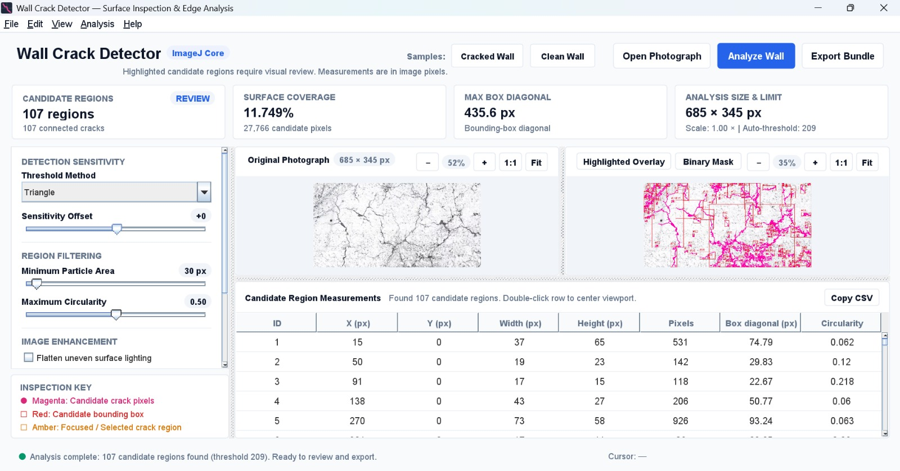

# Wall Crack Detector - Java Application for Detecting Cracks in Walls

This is a simple and easy-to-use desktop application made in Java. It helps you find and mark cracks on wall photos automatically. You just have to load any wall photo, and this software will scan the photo, find crack-like lines, mark them with bright colours, and give you a detailed list with measurements like crack size and location.

It works completely on your computer without needing any internet connection, Python, or machine learning models. It uses the popular ImageJ library for image processing.

---

## Application Preview

Here are sample screenshots showing how the application looks and works:

| Desktop Workspace & Controls | Detected Crack Result |
| :---: | :---: |
|  |  |
| *Desktop workspace with image viewer, settings, and table* | *Detected crack marked with magenta color and red boundary box* |

---

## Table of Contents

- [What Does This Project Do?](#what-does-this-project-do)
- [How Code is Organized](#how-code-is-organized)
- [Step-by-Step Flow of the Project](#step-by-step-flow-of-the-project)
- [How to Run the Project](#how-to-run-the-project)
- [Project Folder Structure](#project-folder-structure)

---

## What Does This Project Do?

In simple words, this project helps civil engineers, building supervisors, and students to quickly check wall photos for cracks without doing manual marking.

Here is what the project does in brief:

1. **Loads Photos Easily**: You can open any common wall photograph (PNG or JPEG) from your computer, or just drag and drop it into the app window.
2. **Cleans the Image**: Wall pictures often have uneven room light and shadows. The application automatically removes bad shadows so that only the actual surface is visible clearly.
3. **Catches Dark Lines (Cracks)**: It automatically scans dark lines running across the wall surface using automated thresholding.
4. **Removes Noise**: It is smart enough to ignore small circular dirt spots, nail holes, and dust dots, picking only long, thin crack lines.
5. **Highlights Cracks Clearly**: 
   - Marked crack pixels are shown in bright **magenta (pink-purple)** colour.
   - Each separate crack gets a numbered **red box** around it.
6. **Shows Complete Measurements Table**: It calculates and displays the exact size, pixel count, diagonal length, circularity, and thickness of every crack found.
7. **Interactive Click & Zoom**: If you click on any crack row in the table, the image immediately zooms and moves directly to that crack so you can inspect it closely.
8. **Export Reports**: With one click, it saves:
   - An overlay picture showing all markings (`overlay.png`)
   - A black-and-white crack mask (`mask.png`)
   - An Excel-friendly CSV table (`regions.csv`)
   - A JSON report for saving records (`report.json`)

---

## How Code is Organized

The entire Java code is organized into neat packages under `src/main/java/org/wallcrack/`. Here is the full breakdown in simple words:

| Package Name | File Name | What This File Does |
| :--- | :--- | :--- |
| **`app`** | `Main.java` | Starting entry point of the project. Checks if you want to open the desktop window or run from command line. |
| **`cli`** | `CommandLine.java` | Runs the project directly from Command Prompt or PowerShell without opening any graphical window. |
| **`detection`** | `CrackDetector.java` | Main brain of the detection engine. Uses ImageJ to remove shadows, apply thresholding, and find connected crack particles. |
| **`io`** | `ImageFiles.java` | Safely opens image files from disk, checks image limits, and handles image loading. |
| **`io`** | `ReportExporter.java` | Generates and saves output files (`overlay.png`, `mask.png`, `regions.csv`, `report.json`) into the output folder. |
| **`io`** | `ResultImages.java` | Draws the visual output by coloring crack pixels in magenta and drawing red numbered boxes on top of the original photo. |
| **`model`** | `CrackRegion.java` | Data model that holds details of a single crack (box coordinates, width, height, pixel count, circularity, thickness). |
| **`model`** | `DetectionConfig.java` | Stores user settings like selected threshold algorithm, sensitivity, minimum crack area, and lighting correction flag. |
| **`model`** | `DetectionResult.java` | Holds the complete output after analysis (all detected cracks list, final mask, threshold used, and coverage percentage). |
| **`ui`** | `DesktopTheme.java` | Contains all styling, fonts, clean button styles, and colors for the desktop application. |
| **`ui`** | `DetectorFrame.java` | Main application window frame with title bar, top menus (File, Analysis, View, Help), and keyboard shortcuts. |
| **`ui`** | `DetectorWorkspace.java` | Main screen workspace that connects the image viewer panel, settings sidebar, status indicators, and measurements table. |
| **`ui`** | `ImagePanel.java` | Interactive canvas where the photo is displayed. Supports smooth mouse wheel zooming, dragging (panning), and pixel inspection. |

---

## Step-by-Step Flow of the Project

Below is the simple 7-step flow of how an image moves through the system from start to finish:

1. **Step 1 - Loading the Photo**:  
   The user opens a wall image. The app checks that the image format is supported and not larger than 40 megapixels to avoid memory slowdowns.

2. **Step 2 - Converting to Grayscale**:  
   The colored photo (RGB) is converted into an 8-bit black-and-white grayscale image using standard luminance weights so brightness differences stand out.

3. **Step 3 - Background Lighting Correction (Optional)**:  
   If the wall has uneven lighting (like a tube light shining brighter on one corner), rolling-ball background subtraction smooths out the gradient so dark shadows are not mistaken for cracks.

4. **Step 4 - Thresholding (ImageJ Engine)**:  
   The application uses an automatic thresholding algorithm (**Triangle** or **Otsu**) to separate dark crack pixels from the brighter background wall surface.

5. **Step 5 - Morphological Closing & Gap Bridging**:  
   Thin hairline cracks often have tiny 1-pixel breaks. Morphological closing (dilation followed by erosion) bridges small broken gaps into one continuous crack line.

6. **Step 6 - Particle Analysis & Filtering**:  
   ImageJ Particle Analyzer scans connected pixels:
   - Filters out tiny spots smaller than the **Minimum Area** (default 30 pixels).
   - Filters out round marks using the **Maximum Circularity** filter (since cracks are long and jagged, not round like nail holes).

7. **Step 7 - UI Display & Report Generation**:  
   The accepted cracks are marked on the photo with magenta overlay and red bounding boxes. All numbers are displayed in the results table, ready to export into CSV, JSON, and PNG files.
