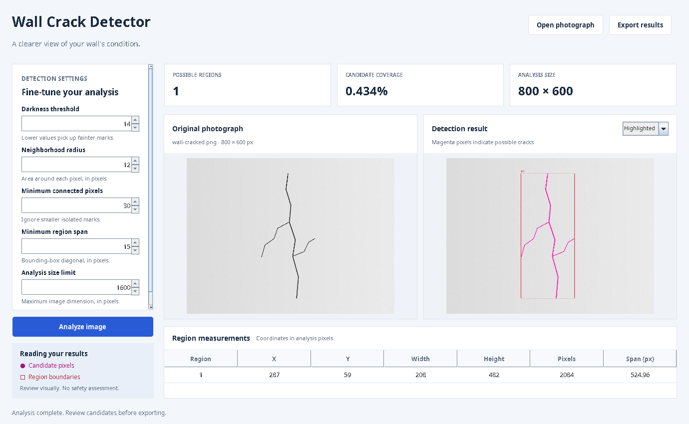
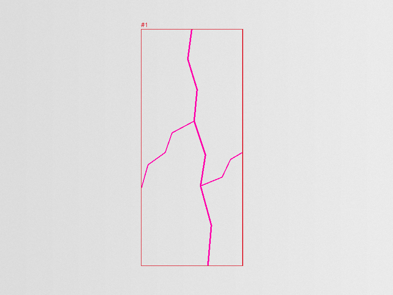

# Wall Crack Detector

A local Java desktop and command-line tool that highlights possible crack-like regions in wall photographs using ImageJ thresholding and particle analysis. It supports interactive review, pixel-space measurements, and PNG/CSV/JSON exports without cloud services or a trained model.

| Desktop inspection workspace | Detected candidate overlay |
| --- | --- |
|  |  |

> [!IMPORTANT]
> This is an educational image-processing tool. Results require visual review and do not determine structural safety, severity, or physical crack width.

## Table of contents

- [Features](#features)
- [Quick start](#quick-start)
- [Desktop workflow](#desktop-workflow)
- [Command-line usage](#command-line-usage)
- [Configuration](#configuration)
- [Exports and measurements](#exports-and-measurements)
- [Detection pipeline](#detection-pipeline)
- [Testing and evaluation](#testing-and-evaluation)
- [Project structure](#project-structure)
- [Documentation](#documentation)
- [Limitations](#limitations)

## Features

- Original, highlighted-overlay, and binary-mask views.
- Interactive zoom, pan, 1:1 inspection, pixel coordinates, RGB, and luminance.
- Triangle or Otsu automatic thresholding with sensitivity adjustment.
- Minimum-area and circularity filters for suppressing noise and compact marks.
- Optional rolling-ball lighting correction and morphological gap closing.
- Sortable candidate table with bounds, pixels, diagonal, circularity, estimated thickness, and orientation.
- Two-way navigation between table rows and highlighted regions.
- Bundled clean and cracked samples, drag-and-drop, and keyboard shortcuts.
- PNG visualizations, CSV measurements, and JSON report export.
- Headless CLI, JUnit regression tests, JaCoCo coverage enforcement, and strict Javadoc.

## Quick start

### Requirements

- JDK 17 or newer
- Maven 3.9 or newer
- A graphical desktop for the Swing interface; CLI analysis works headlessly

Build and launch from the repository root:

```bash
bash scripts/build.sh
java -jar build/wall-crack-detector.jar
```

Or use Maven directly:

```bash
mvn package
java -jar target/wall-crack-detector-1.0.0.jar
```

## Desktop workflow

1. Select **Open Photograph**, drag an image into the window, or load a bundled sample.
2. Adjust detection settings if needed and select **Analyze Wall**.
3. Compare the original, highlighted overlay, and binary mask.
4. Select a table row to highlight a candidate; double-click it to center the viewport.
5. Select **Export Bundle** and choose a new output directory.

Magenta pixels are accepted candidate pixels, red rectangles are candidate bounds, and amber marks the focused region. Changing a detection setting invalidates the old result until the image is analyzed again.

## Command-line usage

```bash
java -jar build/wall-crack-detector.jar \
  --input samples/wall-cracked.png \
  --output output/cracked-demo
```

Expected default summary for the bundled cracked sample:

```text
Candidate regions: 1
Candidate coverage: 0.434%
Analysis: 800 x 600 pixels
Effective threshold: 215
Widest estimated candidate: 4.32 analysis pixels
```

Example with custom settings:

```bash
java -jar build/wall-crack-detector.jar \
  --input "path/to/wall.jpg" \
  --output output/wall-review \
  --method Triangle \
  --sensitivity 5 \
  --min-area 40 \
  --max-circularity 0.40
```

Use a new output directory for every run; report files are never overwritten. Exit codes are `0` for success/help, `1` for I/O failure, and `2` for invalid arguments or unavailable GUI mode.

## Configuration

| Option | Default | Range or behavior |
| --- | --- | --- |
| `--input PATH` | Required in CLI mode | ImageIO-supported image; PNG/JPEG recommended |
| `--output DIR` | `output/analysis` | Created when needed; existing report files are preserved |
| `--method NAME` | `Triangle` | `Triangle` or `Otsu` |
| `--sensitivity N` | `0` | `-50` to `+50`; higher accepts lighter pixels |
| `--min-area N` | `30` | `2` to `100000` connected pixels |
| `--max-circularity F` | `0.50` | `0.01` to `1.00`; lower favors elongated regions |
| `--correct-lighting [BOOL]` | `false` | Flag alone means `true`; explicit `true`/`false` also accepted |
| `--closing N` | `0` | `0` to `10` pixels of morphological closing |
| `--max-dimension N` | `1600` | `64` to `2000` analysis pixels |
| `--gui` | No arguments also open GUI | Requires a graphical display |
| `--help`, `-h` | — | Prints CLI help |

## Exports and measurements

| File | Contents |
| --- | --- |
| `overlay.png` | Photograph with magenta candidate pixels and numbered red bounds |
| `mask.png` | White accepted pixels on a black background |
| `regions.csv` | Candidate bounds, area, diagonal, circularity, thickness estimate, and orientation |
| `report.json` | Schema version, engine, settings, dimensions, threshold, coverage, and regions |

All coordinates are zero-based analysis-image pixels with the origin at the top left. Large inputs are resized proportionally, so reported values refer to the analysis image.

- Coverage: `100 × candidate pixels ÷ analysis pixels`
- Box diagonal: `sqrt(width² + height²)`; not traced crack length
- Circularity: `4 × pi × area ÷ perimeter²`
- Estimated thickness: `candidate pixels ÷ longest bounding-box side`

These are image-space screening measurements, not millimetres, confidence scores, or severity ratings.

## Detection pipeline

1. Validate the input header, enforce the 40-megapixel limit, resize if necessary, and composite transparency onto white.
2. Convert RGB to weighted luminance using `(299R + 587G + 114B + 500) / 1000`.
3. Optionally apply rolling-ball background correction.
4. Calculate a Triangle or Otsu threshold and apply the sensitivity offset.
5. Optionally close small binary gaps with dilation followed by erosion.
6. Run ImageJ particle analysis with area and circularity filters.
7. Create an immutable result, visualizations, measurements, and export reports.

See [Architecture and detection design](docs/ARCHITECTURE.md) for implementation details.

## Testing and evaluation

```bash
bash scripts/test.sh
bash scripts/javadoc.sh
```

`scripts/test.sh` runs JUnit 5, packages the application, generates JaCoCo reports, and enforces the coverage baseline. Open `target/site/jacoco/index.html` for coverage and `build/docs/index.html` for Javadoc.

The regression suite uses reproducible synthetic fixtures to verify software behavior. For real photographs, add consented and labelled images using [the field-evaluation guide](evaluation/README.md), then run:

```bash
bash scripts/evaluate.sh
```

No real-world accuracy claim is made until an appropriate labelled dataset is evaluated.

## Project structure

```text
.
├── .github/workflows/ci.yml        # Java 17/21/25 verification
├── docs/                           # Architecture, development, evaluation, screenshots
├── evaluation/                     # Labelled-field evaluation manifest and guide
├── samples/                        # Reproducible synthetic input images
├── scripts/                        # Build, test, Javadoc, and evaluation commands
├── src/
│   ├── main/java/org/wallcrack/
│   │   ├── app/                    # GUI/CLI entry-point selection
│   │   ├── cli/                    # CLI parsing and workflow
│   │   ├── detection/              # ImageJ detection pipeline
│   │   ├── io/                     # Image loading, rendering, and export
│   │   ├── model/                  # Validated configuration and immutable results
│   │   └── ui/                     # Swing workspace and image navigation
│   └── test/java/org/wallcrack/    # JUnit, regression fixtures, and evaluation harness
├── pom.xml                         # Maven build and dependencies
└── README.md
```

Generated directories such as `target/`, `build/`, and `output/` are intentionally ignored.

## Documentation

- [Architecture and detection design](docs/ARCHITECTURE.md)
- [Development and verification](docs/DEVELOPMENT.md)
- [ImageJ evaluation](docs/IMAGEJ_EVALUATION.md)
- [Synthetic sample provenance](samples/README.md)
- [Labelled field-image evaluation](evaluation/README.md)

## Limitations

- Shadows, seams, cables, joints, stains, and textured paint can resemble cracks.
- Bright, faint, blurred, or very small cracks may be missed.
- Resizing can remove fine detail and changes the measurement coordinate scale.
- Only the first image frame is decoded; EXIF orientation is not applied automatically.
- Inputs larger than 40 megapixels must be resized before loading.
- Zero candidates does not prove that a surface is crack-free.
- The detector has not yet been validated on a representative labelled real-wall dataset.
