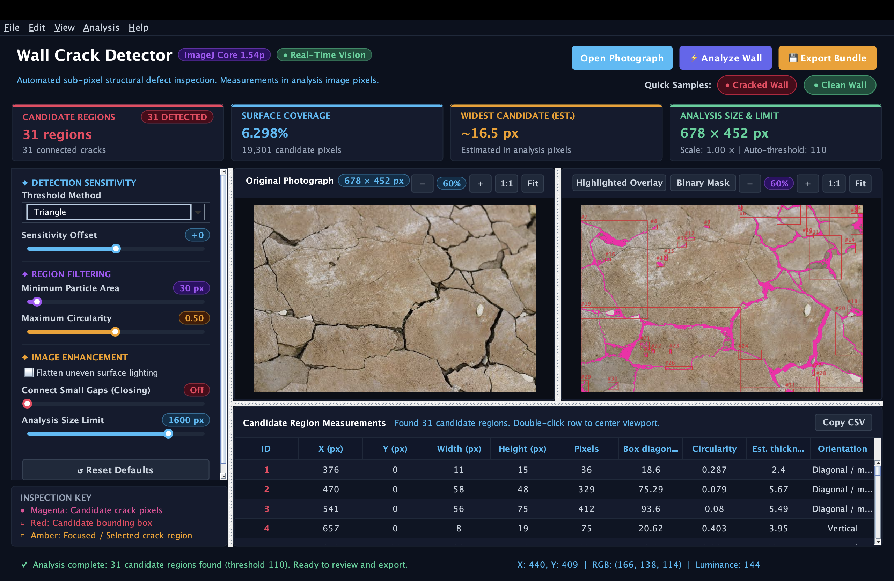
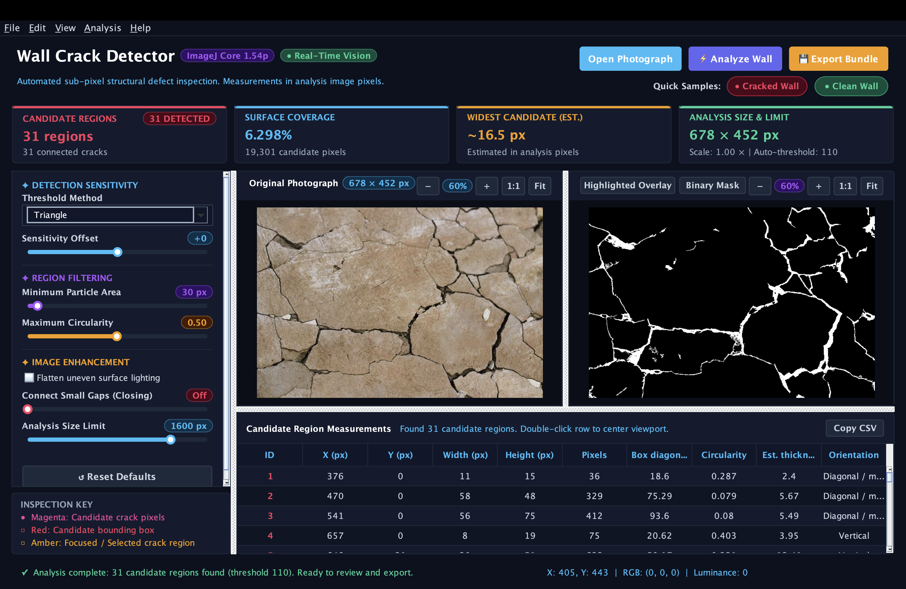

# Wall Crack Detector - Java Application for Detecting Cracks in Walls

A Java desktop app that finds cracks in wall photos, highlights them, and reports each one's size and location in pixels.


---

## Application Preview

Here are sample screenshots showing how the application looks and works:

<table width="100%">
  <tr>
    <th width="50%">Highlighted Overlay View</th>
    <th width="50%">Binary Mask View</th>
  </tr>
  <tr>
    <td width="50%" align="center">
      
    </td>
    <td width="50%" align="center">
      
    </td>
  </tr>
  <tr>
    <td width="50%" align="center"><em>Original photo with candidate pixels in magenta and numbered bounding boxes</em></td>
    <td width="50%" align="center"><em>Binary mask showing accepted candidate pixels on a black background</em></td>
  </tr>
</table>

---

## Table of Contents

- [What Does This Project Do?](#what-does-this-project-do)
- [How Code is Organized](#how-code-is-organized)
- [Step-by-Step Flow of the Project](#step-by-step-flow-of-the-project)
- [How to Run the Project](#how-to-run-the-project)
- [Project Folder Structure](#project-folder-structure)

---

## What Does This Project Do?

In simple words, this project helps civil engineers, building supervisors, and students perform preliminary visual screening of wall photographs without manually marking every possible crack.

Here is what the project does in brief:

1. **Loads Photos Easily**: You can open any common wall photograph (PNG or JPEG) from your computer, or just drag and drop it into the app window.
2. **Handles Uneven Lighting**: When enabled, optional lighting correction reduces gradual brightness changes that could affect detection.
3. **Finds Dark Candidate Lines**: It uses automatic thresholding to identify dark pixels that may belong to cracks.
4. **Filters Common Noise**: Area and circularity filters reject many small or compact marks, although difficult surfaces may still produce false candidates.
5. **Highlights Candidates Clearly**:
   - Accepted candidate pixels are shown in bright **magenta (pink-purple)** colour.
   - Each separate candidate region gets a numbered **red box** around it.
6. **Shows Image-Space Measurements**: It displays the bounding-box size, pixel count, bounding-box diagonal, circularity, and estimated thickness of every accepted candidate.
7. **Interactive Click & Zoom**: If you click on a candidate row in the table, the image immediately zooms and moves to that region so you can inspect it closely.
8. **Export Reports**: With one click, it saves:
   - An overlay picture showing all markings (`overlay.png`)
   - A black-and-white candidate mask (`mask.png`)
   - An Excel-friendly CSV table (`regions.csv`)
   - A JSON report for saving records (`report.json`)

The results require visual review. The application identifies crack candidates and does not assess structural safety.

---

## How Code is Organized

The entire Java code is organized into neat packages under `src/main/java/org/wallcrack/`. Here is the full breakdown in simple words:

| Package Name | File Name | What This File Does |
| :--- | :--- | :--- |
| **`app`** | `Main.java` | Starting entry point of the project. Checks if you want to open the desktop window or run from command line. |
| **`cli`** | `CommandLine.java` | Runs the project directly from Command Prompt or PowerShell without opening any graphical window. |
| **`detection`** | `CrackDetector.java` | Main detection engine. Uses ImageJ for optional lighting correction, thresholding, and connected-region analysis. |
| **`io`** | `ImageFiles.java` | Safely opens image files from disk, checks image limits, and handles image loading. |
| **`io`** | `ReportExporter.java` | Generates and saves output files (`overlay.png`, `mask.png`, `regions.csv`, `report.json`) into the output folder. |
| **`io`** | `ResultImages.java` | Draws the visual output by colouring candidate pixels in magenta and adding red numbered boxes to the original photo. |
| **`model`** | `CrackRegion.java` | Data model that holds details of a candidate region (box coordinates, width, height, pixel count, circularity, estimated thickness). |
| **`model`** | `DetectionConfig.java` | Stores settings such as the threshold algorithm, sensitivity, minimum candidate area, and lighting-correction option. |
| **`model`** | `DetectionResult.java` | Holds the complete output after analysis (candidate list, final mask, threshold used, and coverage percentage). |
| **`ui`** | `DesktopTheme.java` | Contains all styling, fonts, clean button styles, and colors for the desktop application. |
| **`ui`** | `DetectorFrame.java` | Main application window frame with title bar, top menus (File, Analysis, View, Help), and keyboard shortcuts. |
| **`ui`** | `DetectorWorkspace.java` | Main screen workspace that connects the image viewer panel, settings sidebar, status indicators, and measurements table. |
| **`ui`** | `ImagePanel.java` | Interactive canvas where the photo is displayed. Supports smooth mouse wheel zooming, dragging (panning), and pixel inspection. |

---

## Step-by-Step Flow of the Project

Below is the simple 7-step flow of how an image moves through the system from start to finish:

1. **Step 1 - Loading the Photo**:  
   The user opens a wall image. The app checks that the format is supported and enforces a 40-megapixel limit to control memory usage.

2. **Step 2 - Converting to Grayscale**:  
   The colored photo (RGB) is converted into an 8-bit black-and-white grayscale image using standard luminance weights so brightness differences stand out.

3. **Step 3 - Background Lighting Correction (Optional)**:  
   When enabled, rolling-ball background subtraction reduces gradual lighting variations that might otherwise affect thresholding.

4. **Step 4 - Thresholding (ImageJ Engine)**:  
   The application uses an automatic thresholding algorithm (**Triangle** or **Otsu**) to separate dark candidate pixels from the brighter wall background.

5. **Step 5 - Morphological Closing & Gap Bridging**:  
   When enabled, morphological closing (dilation followed by erosion) bridges small gaps between nearby candidate pixels.

6. **Step 6 - Particle Analysis & Filtering**:  
   ImageJ Particle Analyzer scans connected pixels:
   - Filters out tiny spots smaller than the **Minimum Area** (default 30 pixels).
   - Filters compact marks using the **Maximum Circularity** setting because crack-like regions are usually more elongated than circular spots.

7. **Step 7 - UI Display & Report Generation**:  
   Accepted candidate regions are marked with a magenta overlay and red bounding boxes. Their image-space measurements appear in the results table and can be exported as CSV, JSON, and PNG files.

---

## How to Run the Project

### Requirements
- **Java JDK 17 or higher** installed on your computer
- **Maven 3.9+** to build the executable JAR

### Build the JAR
The `build/` folder is not stored in Git. Build the JAR after cloning and rebuild it whenever the source code changes:
```bash
bash scripts/build.sh
```
On Windows without Bash, run `mvn clean package -DskipTests` and copy
`target/wall-crack-detector-1.0.0.jar` to `build/wall-crack-detector.jar`.

### Open the desktop app (Windows, Linux, macOS)
From the project folder:
```bash
java -jar build/wall-crack-detector.jar
```

**App looks tiny on Linux?** Some Java desktop environments may not follow
fractional display scaling correctly. You can start the application at 2× scale:
```bash
java -Dsun.java2d.uiScale=2 -jar build/wall-crack-detector.jar
```

To run detection on an image from command line without opening a window:
```powershell
java -jar build/wall-crack-detector.jar --input src/main/resources/samples/wall-cracked.png --output output/results
```

---

## Project Folder Structure

Here is how the project files and folders are arranged:

```text
CSC360-Group-01/
├── docs/                               # Project documentation and pictures
│   ├── images/                         # Application screenshots
│   │   ├── image_1.png                 # Desktop workflow preview
│   │   ├── image_2.png                 # Detection capabilities preview
│   │   ├── image_3.png                 # Highlighted overlay inspection view (shown above)
│   │   └── image_4.png                 # Binary mask inspection view (shown above)
├── scripts/                            # Helper shell scripts
│   ├── build.sh                        # Builds the executable shaded JAR
│   ├── javadoc.sh                      # Generates Java API documentation
│   └── test.sh                         # Runs all unit tests
├── src/                                # Main Java source code
│   ├── main/java/org/wallcrack/        # Application source files
│   │   ├── app/                        # Application entry point (Main.java)
│   │   ├── cli/                        # Terminal commands (CommandLine.java)
│   │   ├── detection/                  # Detection algorithm (CrackDetector.java)
│   │   ├── io/                         # File loading and exporting
│   │   ├── model/                      # Data models and configurations
│   │   └── ui/                         # Swing UI components (Frame, Workspace, Panel)
│   ├── main/resources/samples/         # Sample wall photos bundled into the JAR
│   │   ├── wall-clean.png              # Clean wall photo without cracks
│   │   └── wall-cracked.png            # Wall photo containing a crack
│   └── test/java/org/wallcrack/        # JUnit regression test suite
├── pom.xml                             # Maven build and dependencies file
└── README.md                           # Main project guide (this file)
```
