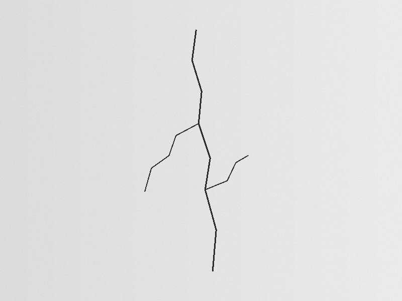

# Wall Crack Detector

A Java desktop and command-line application that highlights **possible cracks
in wall photographs** using local contrast and connected-component analysis.
It runs locally with the Java standard library: no Python, OpenCV, trained model,
or external service is required.

This is an educational image-processing project. Detections need visual review;
the application does not determine structural safety or crack severity.

## Features

- Load photographs and inspect original, highlighted overlay, and binary mask views.
- Interactive pan and zoom with mouse wheel, centering, and 1:1 pixel inspection.
- Real-time cursor coordinates and RGB/luminance pixel inspector.
- Detection presets (Balanced, Hairline, Severe Cracks, Textured Surface, High-Res).
- Tune local darkness, neighborhood size, and candidate size filters with sliders and spinners.
- Measurement table with severity classification badges (Minor, Moderate, Major).
- Bi-directional highlighting: selecting or double-clicking table rows centers on that crack.
- Desktop menu bar with standard keyboard accelerators (Ctrl+O, F5, Ctrl+E, etc.) and Drag & Drop.
- One-click sample loaders for instant testing with bundled wall photographs.
- Export PNG visualizations, CSV measurements, and a JSON analysis report.
- Analyze images from the command line without a graphical display.
- Keep the desktop responsive with background loading, analysis, and export.
- Run dependency-free regression tests and generate strict Javadoc.

## Example

These images are **synthetic**, not real wall photographs or evidence of
real-world accuracy. The default detector finds one connected candidate in the
cracked sample and none in the clean sample.

| Input example | Highlighted candidate |
| --- | --- |
|  |  |

See [sample generation](samples/README.md).

## Requirements and build

- **JDK 17+**, including `java`, `javac`, `jar`, and `javadoc`.
- Bash for the offline scripts (Linux, macOS, WSL, or Git Bash), or Maven 3.9+.
- A graphical desktop for Swing; command-line operation is headless.

From the repository root, build and launch:

```bash
bash scripts/build.sh
java -jar build/wall-crack-detector.jar
```

The Bash build uses only the JDK and works offline. Alternatively, use Maven
(which downloads its build plugins on the first run):

```bash
mvn package
java -jar target/wall-crack-detector-1.0.0.jar
```

`mvn package` compiles, runs the regression suite, and creates the executable
JAR. To use an IDE, open the repository as a Maven project and run
`org.wallcrack.app.Main`. Windows users without Bash can use Maven directly.

## Desktop usage

1. Select **Open photograph** and choose a well-lit wall photo.
2. Adjust settings if necessary, then select **Analyze image**.
3. Use the result selector to switch between **Highlighted** and **Binary mask**,
   then review the measurements table and summary cards.
4. Select **Export results** and choose a new results folder.

Magenta marks accepted pixels; red rectangles identify numbered regions.
Changing settings clears the previous result and disables export until
reanalysis. No arguments, or `--gui`, opens the desktop.

The settings panel scrolls on smaller windows, while **Analyze image** stays
visible. The desktop opens maximized, uses larger controls and text (at least
14-point), and keeps its styling consistent across operating systems. Use the
window's restore button if you prefer a smaller window.


## Command-line usage

```bash
java -jar build/wall-crack-detector.jar \
  --input samples/wall-cracked.png \
  --output output/cracked-demo
```

Expected summary:

```text
Possible crack regions: 1
Candidate coverage: 0.434%
Analysis: 800 x 600 pixels
```

For fainter marks, try a lower threshold:

```bash
java -jar build/wall-crack-detector.jar \
  --input "path/to/wall.jpg" --output output/wall-review \
  --threshold 10 --radius 16 --min-pixels 40 --min-span 20
```

Quote paths containing spaces. On Windows, put arguments on one line instead
of using Bash `\` line continuations. Each invocation processes one image.

| Option | Default | Allowed range / behavior |
| --- | --- | --- |
| `--input PATH` | Required in CLI mode | PNG/JPEG recommended; ImageIO formats supported |
| `--output DIR` | `output/analysis` | Created if necessary; existing reports never replaced |
| `--threshold N` | `14` | 1–100; lower detects fainter marks and more noise |
| `--radius N` | `12` | 2–50 analysis pixels; neighborhood radius |
| `--min-pixels N` | `30` | 2–100000 connected pixels |
| `--min-span N` | `15` | 2–1000; minimum region diagonal in analysis pixels |
| `--max-dimension N` | `1600` | 64–2000; maximum analysis width or height |
| `--gui` | No arguments also opens desktop | Requires a graphical display |
| `--help`, `-h` | — | Show usage instructions |

Use a different output folder for each run. Exit codes are `0` for success/help,
`1` for I/O failures, and `2` for invalid arguments or an unavailable headless
desktop. Zero candidates is a successful analysis, not an error.

## Exports and measurement units

| File | Contents |
| --- | --- |
| `overlay.png` | Analysis image with magenta candidate pixels and numbered red bounds |
| `mask.png` | White accepted pixels on a black background |
| `regions.csv` | `id,x,y,width,height,pixel_count,span_analysis_pixels` |
| `report.json` | Method, original/analysis dimensions, settings, coverage, and regions |

Coordinates are **zero-based analysis-image pixels**, with the origin at the
top left. Images larger than the configured limit are resized proportionally;
small images are not enlarged. Bounds include both edge pixels. Approximate
original coordinates by multiplying X values by `originalWidth / analysisWidth`
and Y values by `originalHeight / analysisHeight`, using floating-point division.

Coverage is `100 × candidate pixels / analysis image pixels`. Span is the
bounding-box diagonal `sqrt(width² + height²)`, not traced crack length.
Measurements are not in millimeters. Neither coverage nor count represents
severity or prediction confidence. A branching crack may be one region;
disconnected pieces may be several. Inputs are never modified. An export error
can leave partial files; choose a new folder when retrying.

## Detection algorithm

1. Resize to the analysis limit and composite transparency on white.
2. Convert RGB to weighted grayscale luminance.
3. Use an integral image to calculate each pixel's local neighborhood mean.
4. Mark pixels darker than that mean by at least the configured threshold.
5. Group marked pixels using eight-connected neighbors, including diagonals.
6. Apply minimum pixel-count/span filters and reject compact shapes using
   `span² / pixelCount < 3.0`.
7. Render the accepted regions and export measurements.

The detector is deterministic and heuristic. See [architecture details](docs/ARCHITECTURE.md).

## Planned ImageJ migration

Using ImageJ is a project requirement. The current implementation does not yet
use it. The [ImageJ migration plan](docs/IMAGEJ_MIGRATION_PLAN.md) describes replacing
the custom detector with ImageJ thresholding, binary processing, and particle
analysis while simplifying settings and retaining the desktop and headless CLI.
It includes evaluation criteria, implementation phases, packaging changes, and
acceptance checks. This is planned work, not an implemented feature.

## Project structure

```text
.
├── pom.xml                         # Maven build and test integration
├── .github/workflows/ci.yml        # Java compatibility and Javadoc checks
├── docs/                          # Architecture, development guide, example overlay
├── samples/                       # Synthetic clean/cracked examples
├── scripts/
│   ├── build.sh                   # Offline compile and executable JAR
│   ├── test.sh                    # Regression suite
│   └── javadoc.sh                 # Strict API documentation generation
└── src/
    ├── main/java/org/wallcrack/
    │   ├── app/                   # Application entry point
    │   ├── cli/                   # Argument parsing and CLI workflow
    │   ├── detection/             # Local contrast and region filtering
    │   ├── io/                    # Image loading, rendering, and exports
    │   ├── model/                 # Configuration and analysis results
    │   └── ui/                    # Swing desktop and previews
    └── test/java/org/wallcrack/    # Regression suite and sample generator
```

`build/`, `target/`, and `output/` are generated directories excluded from Git.

## Tests and Javadoc

```bash
bash scripts/test.sh
bash scripts/javadoc.sh
```

Open `build/docs/index.html` for API documentation. Public APIs and packages
include Javadoc. Both scripts treat warnings as errors. `mvn test` runs the
same 21 regression tests through the Exec Maven Plugin.

The tests cover positive/negative detection, parameter changes, boundaries,
resizing, transparency, immutability, cancellation, decoding, exports, CLI
errors, and headless preview painting. The offline suite and strict Javadoc
were verified on actual JDK 17, 21, and 25 installations. Maven packaging was
also verified on JDK 25 with Java 17 compilation compatibility.
Complete desktop interaction requires manual verification on a graphical
workstation; headless painting does not verify the full UI workflow.
See [development instructions](docs/DEVELOPMENT.md).

## Limitations and future work

- Shadows, seams, cables, brick joints, stains, and textured paint may resemble cracks.
- Bright or faint cracks, blur, and low-resolution images may be missed.
- Broad dark patches can produce edge-shaped candidates; shape filtering is heuristic.
- Resizing may remove fine cracks; parameters refer to the resized image.
- Only the first frame is read; EXIF orientation is not automatically applied.
- Inputs above 40 megapixels must be resized before loading.
- No labeled real-world dataset has been evaluated, so no accuracy claim is made.

Future extensions could add labeled-photo precision/recall evaluation, trained
segmentation, illumination correction, and calibrated physical measurements.
These are not implemented features.

## Feature-based commits

Separate commits record project setup, detection, CLI/exports, the desktop UI,
compatibility fixes, regression tests/samples, and documentation/CI. Review them:

```bash
git log --reverse --oneline
```
