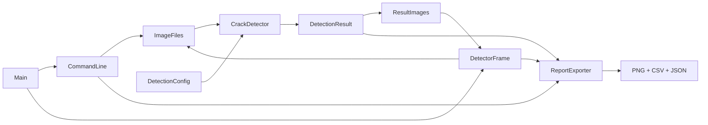

# Architecture and detection design

## Responsibilities and data flow

| Package | Responsibility | Main types |
| --- | --- | --- |
| `app` | Select desktop or CLI | `Main` |
| `cli` | Parse options and return exit codes | `CommandLine` |
| `detection` | Image-to-result analysis via ImageJ core | `CrackDetector` |
| `model` | Validated settings and immutable snapshots | `DetectionConfig`, `DetectionResult`, `CrackRegion` |
| `io` | Decode images, render visualizations, export reports | `ImageFiles`, `ResultImages`, `ReportExporter` |
| `ui` | Desktop controls, theme, and background workflow | `DetectorFrame`, `DetectorWorkspace`, `DesktopTheme`, `ImagePanel` |

## Detection pipeline

1. **Input preparation:**
   Images are resized proportionally if their maximum dimension exceeds the configured limit.
   Transparency is composited onto white RGB canvas.

2. **Grayscale conversion:**
   ImageJ `ColorProcessor` converts RGB to 8-bit `ByteProcessor` using standard perceptual weights:
   `gray = (299*R + 587*G + 114*B + 500) / 1000`.

3. **Optional illumination correction:**
   ImageJ `BackgroundSubtracter` applies rolling-ball background subtraction (`radius = 50`, `lightBackground = true`)
   to suppress broad surface lighting gradients.

4. **Automatic thresholding:**
   ImageJ `AutoThresholder` evaluates the luminance histogram using `Triangle` (default) or `Otsu`.
   The user's sensitivity offset is added, clamped to `[0, 255]`.
   Dark pixels below or equal to the threshold are marked as candidate foreground (value `255`).

5. **Optional binary closing:**
   When configured, ImageJ morphological dilation followed by erosion connects small hairline discontinuities.

6. **Particle analysis:**
   ImageJ `ParticleAnalyzer` processes the binary mask with a private `ResultsTable`.
   Candidates are filtered by minimum particle area and maximum circularity (`4 * pi * area / perimeter²`).
   Accepted particles are extracted into an immutable candidate mask and region collection.

7. **Export and display:**
   Results are rendered into PNG visualizations, CSV records, and a JSON report.

## Results, performance, and threading

`DetectionConfig` validates all parameters upon construction. `CrackRegion` is an immutable record.
`DetectionResult` defensively copies its image, mask, and region list.
Mutable ImageJ processors and tables remain strictly encapsulated inside `CrackDetector`.

Analysis runs in `O(N)` time and auxiliary memory for an image of `N` pixels.
The default analysis limit is 1600 pixels maximum dimension (configurable up to 2000).
Decoders check image metadata first and enforce a 40 megapixel input ceiling.

The Swing desktop executes analysis and export inside a `SwingWorker` background thread,
keeping UI controls responsive and disabled during processing.
CLI commands run headless with explicit exit codes: 0 for success, 1 for I/O errors, 2 for invalid arguments.

## I/O and exports

Exports write `overlay.png`, `mask.png`, `regions.csv`, and `report.json`.
Existing files are never overwritten (`CREATE_NEW`).
Numeric output uses `Locale.ROOT` for international consistency.
