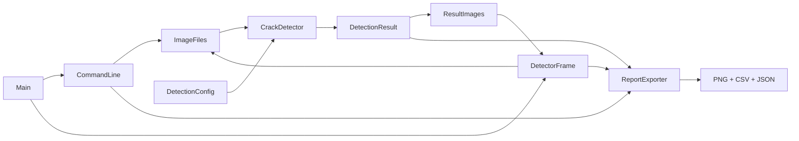

# Architecture and detection design

This document describes the current custom implementation. See the
[ImageJ migration plan](IMAGEJ_MIGRATION_PLAN.md) for the proposed replacement
pipeline, simplified user experience, and implementation checklist. That migration
has not yet been implemented.

## Responsibilities and data flow

| Package | Responsibility | Main types |
| --- | --- | --- |
| `app` | Select desktop or CLI | `Main` |
| `cli` | Parse options and return exit codes | `CommandLine` |
| `detection` | Image-to-result analysis without I/O or UI | `CrackDetector` |
| `model` | Validated settings, presets, and immutable snapshots | `DetectionConfig`, `DetectionPreset`, `DetectionResult`, `CrackRegion` |
| `io` | Decode images, render visualizations, export reports | `ImageFiles`, `ResultImages`, `ReportExporter` |
| `ui` | Desktop controls, theme, and background workflow | `DetectorFrame`, `DetectorWorkspace`, `DesktopTheme`, `ImagePanel` |



## Algorithm

The detector resizes proportionally, never enlarges, and composites transparency
on white. Grayscale uses rounded integer luminance weights:

```text
gray = (299R + 587G + 114B + 500) / 1000
```

A `long[]` integral image stores cumulative luminance. Four lookups produce each
local sum. The square neighborhood has nominal size `(2r + 1)²` and is clipped
at image edges. A pixel is marked when:

```text
localMean(x,y) - gray(x,y) >= contrastThreshold
```

An iterative breadth-first traversal groups eight-connected pixels. Visited
entries are cleared in the temporary mask, and a preallocated integer queue
avoids recursion limits. Each component has inclusive bounds and a pixel count.
It is retained when:

```text
pixelCount >= minComponentPixels
span = hypot(boxWidth, boxHeight) >= minSpan
span² / pixelCount >= 3.0
```

The last rule favors thin or sparse regions over compact filled patches. It
does not prove that a region is a crack. There is no morphology, skeleton
tracing, classifier, probability calibration, or physical calibration.

## Results, performance, and threading

`DetectionConfig` validates constructor parameters. `CrackRegion` is an immutable
record. `DetectionResult` defensively copies its image, mask, and region list;
callers receive new image copies. Coordinates use the analysis image, while
original dimensions remain available for coordinate conversion.

For `N` analyzed pixels, processing takes `O(N)` time and auxiliary memory. The
maximum analysis dimension is 2000 pixels (default 1600). Input decoding is
separately limited to 40 million pixels by checking metadata first. This bounds
ordinary resource use but is not a security boundary for image decoders; large
photos still require adequate JVM heap space.

The detector is stateless and checks interruption between rows and during large
component traversals. The desktop reads/writes Swing controls on the event
dispatch thread. `SwingWorker` handles loading, detection, rendering, and export.
Controls are disabled during work. Setting changes clear old results and disable
export. The CLI explicitly enables headless rendering.

`DetectorFrame` owns the window, while `DetectorWorkspace` owns its contents so
the full layout can be rendered without a display. `DesktopTheme` installs
consistent fonts and control styling across platforms. Settings scroll
independently, the Analyze action remains visible, and both previews share
the same available image area.

## I/O and failure behavior

ImageIO readers are disposed and streams are closed after reading the first
frame. PNG/JPEG are recommended; other support depends on the runtime's readers.

Exports precheck destination names and use `CREATE_NEW` for every file. Existing
reports are never replaced. I/O errors may leave a partial bundle, so retry in a
new directory. Numeric CSV/JSON formatting uses the root locale. CLI argument
errors and I/O failures return distinct exit codes; desktop failures display a
readable dialog and re-enable controls.

## Evaluation boundary

Synthetic fixtures test implementation behavior, not field accuracy. Evaluation
requires labeled photos from varied walls, independent tuning/test sets, and
pixel- or region-level precision/recall. Image pixels alone cannot establish
physical crack width or structural condition.
